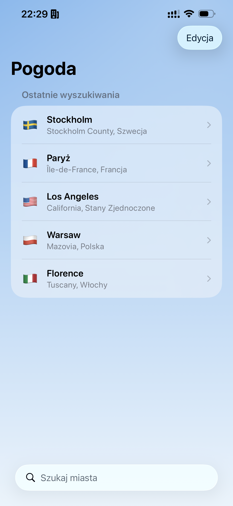
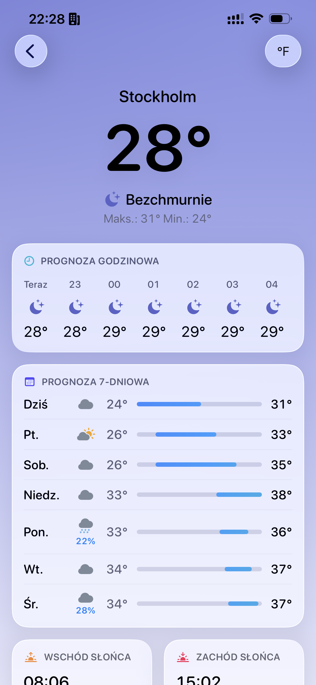
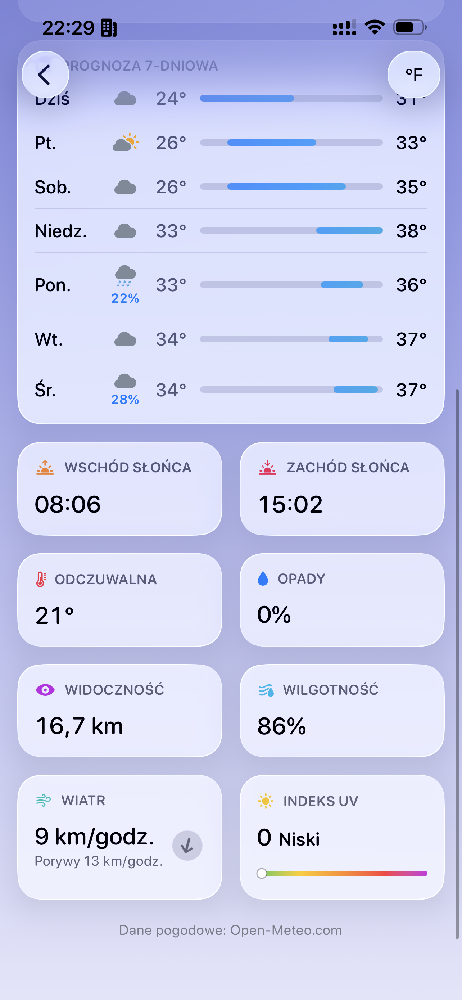
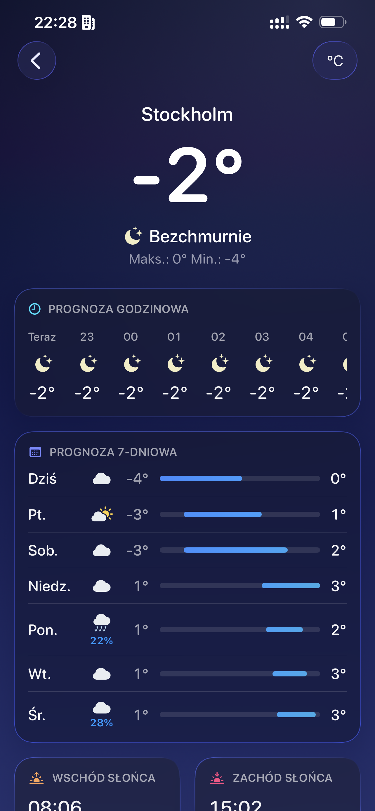
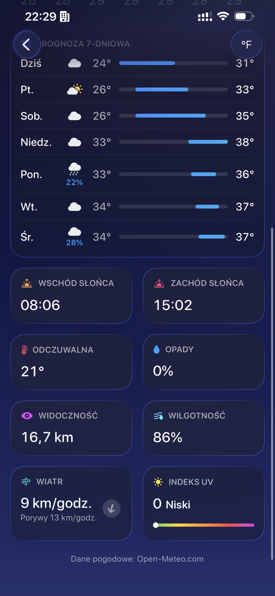
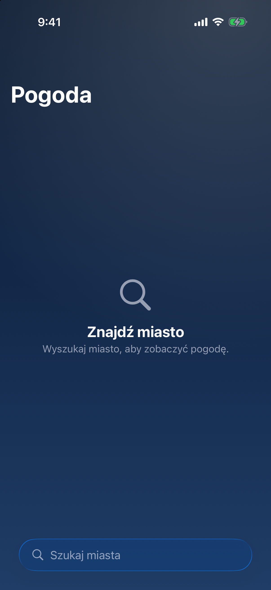
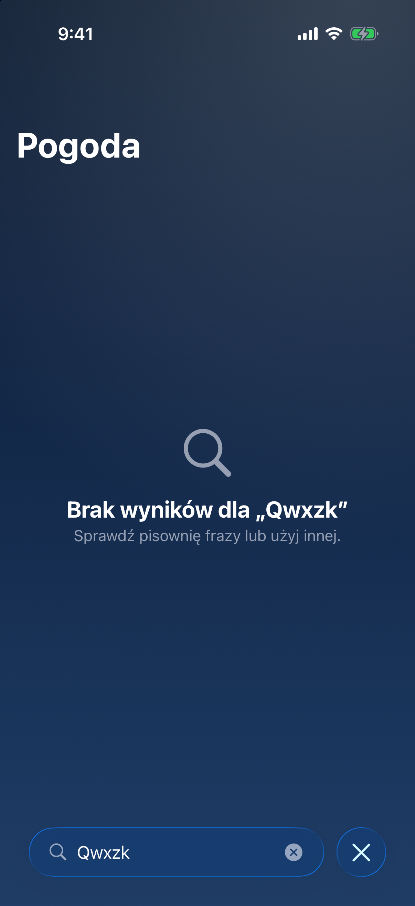

# WeatherForecast

Aplikacja pogodowa na iOS napisana w SwiftUI i Swift 6. Pozwala wyszukać dowolne miasto i zobaczyć aktualne warunki, prognozę na 24 godziny i 7 dni oraz szczegóły, które przydają się w ciągu dnia. Ostatnie wyszukiwania są zapisywane na urządzeniu.

Dane pogodowe i geokodowanie pochodzą z [Open-Meteo](https://open-meteo.com), więc klucz API nie jest potrzebny.

<table>
  <tr>
    <td></td>
    <td></td>
    <td></td>
  </tr>
  <tr>
    <td></td>
    <td></td>
    <td></td>
  </tr>
  <tr>
    <td></td>
    <td></td>
    <td></td>
  </tr>
</table>

## Funkcje

- **Wyszukiwanie miast** z opóźnieniem zapytań (debounce), podpowiedziami przy niedokończonych nazwach i wynikami w języku urządzenia
- **Ostatnie wyszukiwania** od najnowszych, maksymalnie 20, z usuwaniem gestem przesunięcia lub w trybie edycji; zapisywane jako JSON w Application Support
- **Aktualne warunki** na tle, które zmienia się zależnie od pogody i pory dnia
- **Prognoza godzinowa** na najbliższe 24 godziny w strefie czasowej wybranego miasta, z szansą opadów i oznaczeniem ryzyka burzy
- **Prognoza 7-dniowa** z paskami zakresu temperatur kolorowanymi według stałej skali, więc ta sama temperatura ma zawsze ten sam kolor
- **Kafelki szczegółów**: wschód i zachód słońca, temperatura odczuwalna, opady, widoczność, wilgotność, wiatr z porywami i kierunkiem oraz indeks UV
- **Brak połączenia**: bez internetu wyszukiwanie i prognoza pokazują komunikat „Brak połączenia z internetem” z przyciskiem „Spróbuj ponownie”, a inne błędy mają osobny komunikat
- **Puste stany**: pusta historia zachęca do wyszukania miasta („Znajdź miasto”), a wyszukiwanie bez wyników pokazuje „Brak wyników” z podpowiedzią
- **Stopnie Celsjusza i Fahrenheita**, domyślnie według regionu urządzenia, z zapamiętanym wyborem
- **Tryb jasny i ciemny**, łącznie z ikoną aplikacji i ekranem startowym
- **Układy dla dużego tekstu** przy rozmiarach dostępności oraz szkielety ładowania respektujące ustawienie „Ogranicz ruch”
- **Angielski i polski** dzięki String Catalogs

## Architektura

Aplikacja ma budowę warstwową. Wszystko, co nie jest interfejsem, znajduje się w lokalnym pakiecie Swift, więc logikę biznesową można budować i testować bez targetu aplikacji.

```
WeatherForecast/            Target aplikacji (SwiftUI)
├── App/                    Punkt wejścia, łączenie zależności, nawigacja
├── Features/               Home, Search, History, Forecast
├── Shared/                 Design system, wiersze miast, prezentacja pogody
└── Resources/              String Catalogs, zasoby

Modules/                    Pakiet Swift
├── Domain                  Modele, protokoły usług, walidacja
├── Networking              Protokół HTTPClient i klient oparty na URLSession
├── OpenMeteo               Wyszukiwanie miast i prognoza, mapowanie odpowiedzi
└── Persistence             Repozytorium historii wyszukiwań zapisywane w pliku
```

Zależności są skierowane do środka: `OpenMeteo` i `Persistence` zależą od `Domain`, a `Domain` nie zależy od niczego. Aplikacja korzysta z protokołów (`CitySearching`, `ForecastProviding`, `SearchHistoryRepository`), a `AppDependencies` łączy je z prawdziwymi implementacjami w jednym miejscu.

Najważniejsze decyzje:

- **Observation i view modele.** Ekrany opierają się na view modelach `@Observable` z jawnym enumem `State` (`loading`, `loaded`, `failed`), więc każdy stan można sprawdzić w teście.
- **Ścisła współbieżność.** Cały projekt działa w trybie języka Swift 6, a pakiet dodatkowo włącza `NonisolatedNonsendingByDefault` i `InferIsolatedConformances`. Repozytorium historii jest aktorem, a zapisy historii wykonują się po kolei, więc szybka seria dotknięć nie zapisze danych w złej kolejności.
- **Anulowanie.** Wyszukiwanie zastąpione nowszym zapytaniem jest anulowane, a jego spóźnione wyniki lub błędy są ignorowane.
- **Obsługa błędów.** Błędy sieci i dekodowania są mapowane na prosty `WeatherError` z komunikatem dla użytkownika i przyciskiem ponowienia. Jeśli pliku historii nie da się odczytać, lista startuje pusta zamiast blokować aplikację.
- **Strefy czasowe.** Godziny w prognozie są pokazywane w strefie czasowej wyszukanego miasta, a nie urządzenia.

## Wymagania

- Xcode 26 lub nowszy
- iOS 17 lub nowszy

## Uruchomienie

```bash
git clone https://github.com/nhrysiuk/WeatherForecast.git
```

```bash
open WeatherForecast/WeatherForecast.xcodeproj
```

Wybierz schemat `WeatherForecast` i uruchom aplikację. Klucze ani konfiguracja nie są potrzebne.

## Testy

Testy są napisane w Swift Testing. Pakiet obejmuje walidację, zasady historii, ryzyko burzy, klienta HTTP (z podstawionym `URLProtocol`), mapowanie odpowiedzi Open-Meteo i repozytorium plikowe. Testy aplikacji obejmują view modele, magazyn historii, router oraz formatowanie i kolory temperatur.

Testy aplikacji uruchomisz w Xcode skrótem ⌘U. Pakiet jest przeznaczony tylko dla iOS, więc jego testy uruchamia się na symulatorze:

```bash
cd Modules && xcodebuild test -scheme Modules-Package -destination "platform=iOS Simulator,name=iPhone 17 Pro"
```

CI w GitHub Actions uruchamia oba zestawy testów przy każdym pull requeście do `main`.

## Źródła danych

Dane pogodowe: [Open-Meteo](https://open-meteo.com), licencja [CC BY 4.0](https://creativecommons.org/licenses/by/4.0/).
